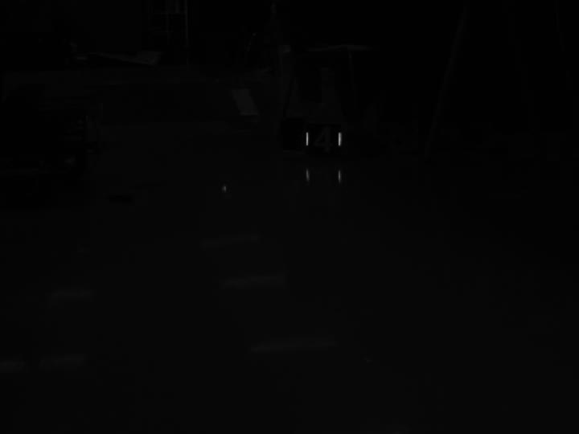
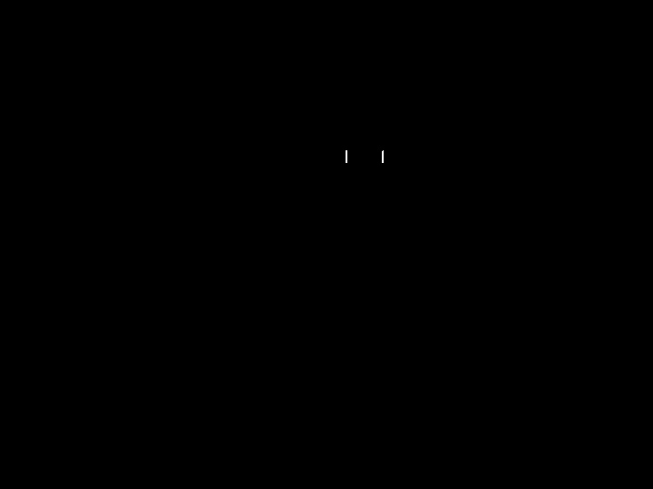
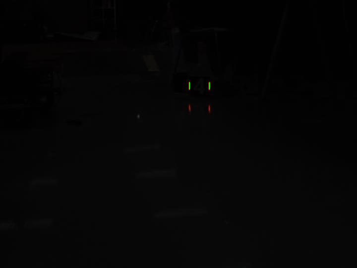

# RoboMaster 算法组培训阶段二：灯条识别

## 中期进度（2026-10-23）

当前完成了 OpenCV 4.5.4 源码编译安装、CMake 项目搭建，以及视频第一帧的灯条提取、轮廓绘制和上下端点计算。当前程序只处理第一帧，尚未完成整个视频的逐帧识别和装甲板连线。

## 实现思路

1. 使用 `cv::VideoCapture` 打开提供的装甲板视频，通过 `read` 读取第一帧，保存到 `cv::Mat`。
2. 使用 `cv::cvtColor` 将 BGR 彩色图转换为灰度图。
3. 使用 `cv::threshold` 进行二值化，当前阈值为 100：灰度值大于 100 的像素设为 255，其余设为 0。
4. 使用 `cv::findContours` 提取外轮廓，使用 `CHAIN_APPROX_SIMPLE` 压缩轮廓点。
5. 使用 `cv::minAreaRect` 计算每条轮廓的最小外接旋转矩形，并取得四个顶点。
6. 比较相邻边长度，找到两条短边，取短边中点作为灯条两端，再按 y 坐标区分上下端点。
7. 使用 `cv::drawContours` 将轮廓用绿色画回原图，保存结果。

## 当前验证结果

- 第一帧尺寸：720 × 540。
- 二值化后找到 2 条轮廓，对应图中的两根灯条；本帧下方较暗的反光基本被过滤。
- 左灯条：中心 `(381.5, 172.5)`，上端点 `(381.5, 166)`，下端点 `(381.5, 179)`。
- 右灯条：中心 `(421.5, 172.5)`，上端点 `(421.5, 166)`，下端点 `(421.5, 179)`。
- 两个旋转矩形输出尺寸均为 `13 × 1`，角度为 `90` 度。此处尺寸是轮廓点的几何跨度，角度与旋转矩形自身边方向有关。
- 已完成编译和运行验证。

## 效果图

### 视频第一帧


### 灰度图


### 二值化结果


### 轮廓绘制结果


## 开发环境与项目结构

Mac 上使用 VS Code，通过 Remote SSH 在 Linux 中开发和运行；使用 C++14、CMake 和 OpenCV 4.5.4。

```text
armor-detection/
├── CMakeLists.txt
├── README.md
├── src/
│   └── main.cpp
├── assets/
│   └── armor.avi
├── first_frame.jpg
├── gray.jpg
├── binary.jpg
└── contours.png
```

`build/` 为本地构建目录，不提交到仓库。`assets/armor.avi` 为培训提供的视频素材。

## 编译和运行

先按培训要求安装 OpenCV 4.5.4。当前 CMake 配置使用的 OpenCV 配置目录为：

```text
/usr/local/opencv4.5.4/lib/cmake/opencv4
```

如果安装位置不同，需要修改 `CMakeLists.txt` 中的 `OpenCV_DIR`。在项目根目录运行：

```bash
cmake -S . -B build
cmake --build build -j3
./build/armor_detection
```

程序使用相对路径 `assets/armor.avi`，因此需要从项目根目录启动。运行后会输出轮廓、顶点、中心和端点信息，并在当前目录保存以上四张图片。

## 遇到的问题与处理

- Mac 与教程中的 Windows/WSL 环境不同：安装与编译在 SSH 连接的 Linux 中完成，将 Mac 下载的源码和视频上传到 Linux。
- 最初下载了其他 OpenCV 版本，随后改用培训要求的 4.5.4 并运行版本工具确认。
- CMake 配置期间需要下载 ADE 依赖，等待下载后配置成功。
- 编译命令前误输入额外字符，导致编译失败，而后续运行的是旧程序；去掉额外字符，保存源码后重新编译运行。
- `findContours` 的输出顺序不能代表灯条左右位置，需要比较中心 x 坐标；图像坐标向右 x 增大、向下 y 增大。
- 旋转矩形的宽高不直接代表图像水平和竖直方向，使用短边中点计算灯条端点。

## 尚未完成与后续计划

- 将单帧流程改为循环读取，验证整个视频。
- 增加灯条形状筛选、颜色筛选与两灯条配对，减少复杂背景下的误检。
- 将两根灯条的四个端点按顺序连接，绘制装甲板边框。
- 输出可逐帧查看的结果或处理后的视频。
- 当前固定灰度阈值只在第一帧验证，其他帧可能需要调整；端点标注绘图尚未加入当前代码。
- PnP 位姿解算属于选做内容，目前未实现。
